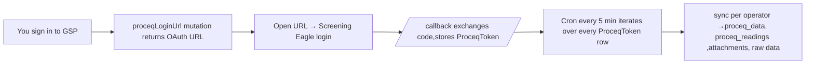

# Proceq Flow — Testing Guide

> Step-by-step guide for a first-time developer to set up, authenticate, and verify the Proceq data synchronisation pipeline locally.

For the architectural background (what each service does, the elongation maths, the data model), read [`docs/techinal-design-document.md`](../../docs/techinal-design-document.md) — sections 5–13 cover this pipeline end-to-end. **This file is the operational "how to run it" companion.**

---

## Table of Contents

1. [Prerequisites](#prerequisites)
2. [What you'll end up with](#what-youll-end-up-with)
3. [Step 1 — Database setup](#step-1--database-setup)
4. [Step 2 — Environment variables](#step-2--environment-variables)
5. [Step 3 — Start the API](#step-3--start-the-api)
6. [Step 4 — Authenticate with Proceq (per-user OAuth)](#step-4--authenticate-with-proceq-per-user-oauth)
7. [Step 5 — Automatic sync](#step-5--automatic-sync)
8. [Step 6 — Where to find the synced data](#step-6--where-to-find-the-synced-data)
9. [Step 7 — Verifying the sync](#step-7--verifying-the-sync)
10. [Troubleshooting](#troubleshooting)
11. [Internals at a glance](#internals-at-a-glance)

---

## Prerequisites

| Requirement | Why |
|---|---|
| **Node.js** (LTS) and **pnpm** | Monorepo tooling. |
| **PostgreSQL** running locally (or via Docker) | Backing store for `proceq_*` and `banshee_*` tables. |
| **`DATABASE_URL`** set in `apps/api/.env` | Prisma needs it to migrate / seed. |
| **A GraphQL client** (Insomnia, Postman, Apollo Sandbox, or `curl`) | To call the Proceq login mutation. |
| **A GSP user account** that can sign in to `/auth/signin` | The login URL is JWT-protected. |
| **A Screening Eagle (Proceq) account** | This is the *identity that owns the FDL measurements*. It does not have to match your GSP account email, but the email you sign in to Screening Eagle with becomes the key in `proceq_tokens`. |
| **Proceq OAuth client credentials** | Ask the team / pull from 1Password (see [Step 2](#step-2--environment-variables)). |

---

## What you'll end up with

After completing this guide, you should see:

1. A row in `proceq_tokens` keyed by your Screening Eagle email.
2. Periodic console logs (every 5 minutes) showing the cron firing and processing measurements.
3. `proceq_data` / `proceq_readings` rows populated, with `bansheeRequestId` filled for any measurement whose `fileName` matches a seeded `BansheeRequest.serialNumber`.
4. Two on-disk directories under `apps/api/`: `logs/` (raw export archives) and `proceq-data/` (attachments + raw waveform data).



---

## Step 1 — Database setup

### 1.1 Apply Prisma migrations

```bash
cd apps/api
npx prisma migrate dev
```

This creates the schema: `proceq_data`, `proceq_readings`, `proceq_tokens`, `proceq_attachments`, `banshee_requests`, `banshee_session_stats`, `bolt_type_constants`, plus the Banshee scheduling tables (`cart_items`, `orders`, `order_items`).

### 1.2 Seed the core hierarchy first

The Banshee seed depends on an existing **Company → Site → Level → Drive → Location** chain. If your DB is empty, run the main seed first:

```bash
cd apps/api/prisma
npx ts-node seed.ts
```

### 1.3 Seed Banshee fixtures

```bash
cd apps/api/prisma
npx ts-node seed-banshee.ts
```

This inserts:

- Multiple `BansheeRequest` rows with predictable serial numbers (e.g. `MDX-U-50`, `MD-95001`, `corrosion grid001`). These are what synced measurements get linked against.
- At least one `BoltTypeConstant` row — required for elongation/status computation. Without it, `status` stays `null` on every reading.

> **Tip:** to test the "linked vs unlinked" behaviour, pick a Screening Eagle measurement whose `fileName` starts with one of the seeded serial numbers. Measurements that don't match are still synced — they just won't have `bansheeRequestId` set.

---

## Step 2 — Environment variables

Set these in `apps/api/.env`:

```env
# Proceq OAuth (get values from 1Password / team-admin — do NOT commit secrets)
PROCEQ_CLIENT_ID=<ask team>
PROCEQ_CLIENT_SECRET=<ask team>
PROCEQ_SCOPE=openid email profile offline
PROCEQ_WORKSPACE_DOMAIN=io.screeningeagle.com         # prod
PROCEQ_REGIONAL_DOMAIN=sg-io.screeningeagle.com       # prod
PROCEQ_REDIRECT_URI=http://localhost:3333/callback

# DB
DATABASE_URL=postgresql://...
```

### Staging credentials

If prod tells you the app isn't registered for your redirect URI, switch to the staging client:

```env
PROCEQ_CLIENT_ID=<ask team>
PROCEQ_CLIENT_SECRET=<ask team>
PROCEQ_WORKSPACE_DOMAIN=stg-io.screeningeagle.com
PROCEQ_REGIONAL_DOMAIN=sg-stg-io.screeningeagle.com
```

> **Security note**
> Production `PROCEQ_CLIENT_SECRET` is *not* checked into this repo. Pull it from the team password manager. If you ever paste a real secret into this file, rotate it immediately.

### Redirect URI must match exactly

`PROCEQ_REDIRECT_URI` must match a redirect URI registered with the Screening Eagle client app exactly — port included.

**If the callback fails with `"Redirect URL is not registered for this app"` on `3333`**, the registered URI is likely on a different port. The known-good fallback is **port `3000`**:

1. In `apps/api/.env`, change:
   ```env
   PROCEQ_REDIRECT_URI=http://localhost:3000/callback
   ```
2. In `apps/api/src/main.ts`, change the API listen port from `3333` to `3000`.
3. Restart the API and re-run [Step 4](#step-4--authenticate-with-proceq-per-user-oauth).

Both values must change together — if only the env var moves but `main.ts` still listens on `3333`, the browser redirect will hit nothing. If you change to *any* other port, that exact URI must also be added to the Screening Eagle client registration by an admin.

---

## Step 3 — Start the API

```bash
cd apps/api
pnpm run start:dev
```

Server boots on **`http://localhost:3333`**. You should see Nest module logs and — if a previous developer already authenticated — a "No Proceq tokens found, skipping sync" debug line on the first cron tick (every 5 minutes).

---

## Step 4 — Authenticate with Proceq (per-user OAuth)

> **What changed from the legacy guide:** there is **no hardcoded `OPERATOR_EMAIL` constant** anymore. The operator email is derived from the GSP user who calls the login mutation (via JWT) and embedded into the OAuth `state`, so multiple developers/operators can have independent tokens in `proceq_tokens` simultaneously.

### 4.1 Sign in to GSP

Authenticate against your local API so you get a JWT. From Insomnia / Postman / the web app, hit:

```
POST /auth/signin
```

with valid GSP credentials. Copy the returned JWT — you'll need it for the next call.

### 4.2 Request the Proceq login URL

Call the `proceqLoginUrl` GraphQL query with your JWT as `Authorization: Bearer <token>`. The `callbackUrl` is where Screening Eagle should redirect *your browser* back to after login (in local dev, point this at your web app — e.g. the banshee app — so the redirect lands on a real page).

```graphql
query {
  proceqLoginUrl(callbackUrl: "http://localhost:3000") {
    url
  }
}
```

The response `url` is a Screening Eagle authorize URL with a base64-encoded `state` containing your email + `callbackUrl`. Open it in a browser.

> The Insomnia collection in `apps/api/` ships this query under `BansheeRequest/ProceqSignIn` — use that for convenience.

### 4.3 Complete OAuth in the browser

1. Sign in to Screening Eagle with **the account that owns the FDL measurements you want to sync**.
2. Screening Eagle redirects to `http://localhost:3333/callback?code=...&state=...`.
3. The `ProceqAuthController.callback` handler:
   - Decodes `state` to recover your email + `callbackUrl`.
   - Calls `setAuthorizationCode(code, email)` — exchanges the code for `{accessToken, refreshToken, expiresAt}` and upserts `proceq_tokens` keyed by `operatorEmail`.
   - Redirects your browser to `<callbackUrl>?proceq=success` (or `?proceq=failed`).

Verify with Prisma Studio (`pnpm run prisma:studio`, opens at `http://localhost:5555`) that the row exists in `proceq_tokens` with your email.

### 4.4 Token refresh — what happens automatically

- Tokens are auto-refreshed **60 seconds before expiry** by `ProceqAuthService`.
- A `refreshPromise` mutex guarantees only one refresh is in-flight at a time.
- On server restart, `initializeTokenFromDB()` loads each stored token; nothing more is required from you.

If refresh fails (e.g. refresh token revoked at the Proceq side), re-run Step 4.

---

## Step 5 — Automatic sync

### 5.1 The cron

```ts
@Cron('0 */5 * * * *')   // every 5 minutes
```

`ProceqSchedulerService.handleProceqSync` reads **every** row in `proceq_tokens` and runs `syncAllMeasurements(operatorEmail)` for each one — so if three developers are authenticated, three independent sync passes fire per tick.

You don't need to trigger anything manually. After ~5 minutes you'll see logs of the form:

```
[ProceqSchedulerService] Triggered Proceq data synchronization
[ProceqSchedulerService] Starting sync for 1 users
[ProceqSyncService] Starting Proceq data synchronization
[ProceqSyncService] Found 450 total measurements, 5 pages to process
[ProceqSyncService] Total measurements processed: 450, New: 12, Updated: 3
[ProceqSyncService] Starting batch processing with batch size 100 for 15 measurements
[ProceqSyncService] Progress: 100.00% (15/15)
[ProceqSyncService] Sync completed in 45230ms. New: 12, Updated: 3, Failed batches: 0
[ProceqSchedulerService] Proceq sync for you@sandvik.com completed in 45230ms — scanned: 450, new: 12
```

### 5.2 Sync internals (cheat sheet)

| Aspect | Value | Source |
|---|---|---|
| Cron expression | `0 */5 * * * *` (every 5 min) | `proceq-scheduler.service.ts` |
| Concurrency guard | `isSyncing` flag per operator — overlapping runs are skipped | `proceq-sync.service.ts` |
| Batch size | 100 measurements per export request | `MAX_BATCH_SIZE` |
| Export poll interval | 3 s | `EXPORT_POLL_INTERVAL` |
| Export timeout | 5 min per batch | `EXPORT_TIMEOUT` |
| Attachment concurrency | 5 measurements in parallel (background, non-blocking) | `processAttachments()` |
| Re-sync detection | Measurements with a newer `updatedAt` are re-processed; status deltas write `BansheeEventLog` rows | `bulkUpsertProceqData()` |

For the full pipeline (extract → match → compute → upsert → log status changes), see TDD §5–11.

### 5.3 Triggering a sync immediately (optional)

If you can't wait 5 minutes, the cleanest way is to restart the server while temporarily lowering the cron interval (e.g. `*/30 * * * * *` for every 30 s) — remember to revert it before committing. There is no exposed HTTP route to force-run the sync.

---

## Step 6 — Where to find the synced data

### 6.1 Prisma Studio

```bash
cd apps/api
pnpm run prisma:studio   # http://localhost:5555
```

| Table | What to look for |
|---|---|
| `proceq_tokens` | One row per authenticated operator (`accessToken`, `refreshToken`, `expiresAt`). |
| `proceq_data` | Synced measurements — `fileName`, `operatorEmail`, `comments`, `temperature`, `status`, `bansheeRequestId`, `dueDate`. |
| `proceq_readings` | Per-reading values (`frequency`, `gain`, `velocity`, `gate1*`, `elongation`, `status`). |
| `proceq_attachments` | Downloaded photo/audio metadata (`filePath`, `attachmentType`, `fileSize`). |
| `banshee_requests` | `isProceqSynced = true` for any request matched by serial number. |
| `banshee_event_logs` | `STATUS_CHANGE` rows when a measurement's status changes between syncs. |
| `banshee_session_stats` | Daily aggregates: `totalMeasured`, `notMeasurable`, `broken` (per company × site × date). |
| `bolt_type_constants` | Bolt physical constants used by `computeStatusForRecords()`. |

### 6.2 Local filesystem (gitignored)

```
apps/api/
├── logs/                                ← downloaded export archives
│   ├── <export-id>.zip                  ← raw export ZIP from Proceq
│   └── <export-id>/                     ← unzipped contents
│       └── JSON_<name>/
│           └── <measurement-id>/<file>.json
└── proceq-data/                         ← attachments + raw waveform data
    ├── attachments/<measurementId>/
    │   ├── photo1.jpg, photo2.png       ← user photos
    │   └── audio.mp3                    ← audio (rare)
    └── raw-data/
        ├── <measurementId>_raw.json     ← raw ultrasonic waveform
        └── <measurementId>_raw.zip      ← compressed copy referenced by ProceqData.rawDataZipPath
```

Inspect these when DB rows look right but you want to confirm the source-of-truth payload.

---

## Step 7 — Verifying the sync

### Verification checklist

- [ ] **Token stored** — `proceq_tokens` has a row with your Screening Eagle email.
- [ ] **Cron fired** — console shows `Triggered Proceq data synchronization`.
- [ ] **Measurements pulled** — `proceq_data` row count grew.
- [ ] **Readings populated** — each `proceq_data` row has ≥ 1 `proceq_readings` child (or the synthetic placeholder reading when source had none).
- [ ] **BansheeRequest linked** — for any measurement whose `fileName` starts with a seeded `serialNumber`, that `banshee_requests.isProceqSynced` is now `true` and `proceq_data.bansheeRequestId` is set.
- [ ] **Elongation computed** — `proceq_readings.elongation` is non-null wherever both `temperature` (parsed from the operator's comment) and `gate1SoundPathDistanceInTimeUnit` are present.
- [ ] **Status assigned** — `proceq_readings.status` ∈ {`Elastic`, `Low plastic`, `High plastic`, `broken`, `not measurable`}; the parent `proceq_data.status` mirrors the last reading.
- [ ] **dueDate projected** — for linked measurements where `BansheeRequest.period > 0`, `proceq_data.dueDate` = `updatedTimestamp + period months`.
- [ ] **Event log** — on the *second* sync of a measurement whose status changed, a new `banshee_event_logs` row appears with `eventType = STATUS_CHANGE`.
- [ ] **Stats updated** — `banshee_session_stats` has a row for the measurement's date.
- [ ] **Attachments downloaded** — `proceq-data/attachments/<measurementId>/` populated with media files; `proceq_attachments` rows reference them.
- [ ] **Raw data saved** — `proceq-data/raw-data/` has `<measurementId>_raw.json` + `.zip`.
- [ ] **Logs folder** — `logs/<export-id>.zip` and the unzipped tree exist for each batch.

### What's normal vs. what's wrong

| Observation | Interpretation |
|---|---|
| Measurement saved but `bansheeRequestId` is `null` | **Normal.** No `BansheeRequest.serialNumber` matched `fileName`'s base. Seed a matching request or move on. |
| `proceq_readings.status` and `elongation` are `null` | Either the operator's comment didn't include `"temperature NN"` (regex parse), or `gate1SoundPathDistanceInTimeUnit` is missing in the reading. Both are required for the calculation. |
| Status is `broken` / `not measurable` with `elongation = null` | **Normal.** Comment-based pre-check short-circuits the math. |
| Same measurement re-appears in logs after a few syncs | **Normal.** Re-sync detects changed `updatedAt` and re-upserts. |

---

## Troubleshooting

| Issue | Fix |
|---|---|
| **`No Proceq tokens found, skipping sync`** | You haven't completed Step 4 yet for any operator. |
| **`Proceq sync for <email> was skipped (already running)`** | The previous run is still active for that operator. Wait or check for a hung export. |
| **401 from Proceq mid-sync** | Token refresh failed. Re-run Step 4 to re-issue a refresh token. |
| **`Redirect URL is not registered for this app`** | `PROCEQ_REDIRECT_URI` doesn't match the URI registered in the Proceq client app. Either switch to the staging client (different registration), revert your local port to `3333`, or ask the team to register your URI. |
| **`PROCEQ_REGIONAL_DOMAIN environment variable is not set`** | `.env` not loaded or variable missing. Restart the server after editing `.env`. |
| **Export timeout** | A 100-batch export exceeded 5 min. Usually a network/Proceq-side hiccup; the failed batch is logged and skipped — the next cron will retry. |
| **`No BansheeRequest found for serial …`** | Expected for unlinked measurements; the row is still saved. To link, seed/create a `BansheeRequest` whose `serialNumber` matches `fileName`'s base. |
| **Status / elongation always `null` for a linked measurement** | (1) Operator comment lacks `temperature NN` ⇒ no temp parsed. (2) `gate1SoundPathDistanceInTimeUnit` missing in reading. (3) `BoltTypeConstant` row absent for that `boltType`. |
| **`Cannot read attachment ZIP`** | Some Proceq attachments are wrapped in archives. If a specific attachment fails, the rest of the sync continues — `processAttachments` is isolated. |

---

## Internals at a glance

Helpful pointers if you need to dig deeper than this guide:

| Concern | Code path |
|---|---|
| OAuth + token storage | [`proceq-auth.service.ts`](src/proceq/proceq-auth.service.ts), [`proceq-auth.controller.ts`](src/proceq/proceq-auth.controller.ts), [`proceq-auth.resolver.ts`](src/proceq/proceq-auth.resolver.ts) |
| Cron entry point | [`proceq-scheduler.service.ts`](src/proceq/proceq-scheduler.service.ts) |
| HTTP client (with retry) | [`proceq-api.service.ts`](src/proceq/proceq-api.service.ts) |
| Sync pipeline (extraction → match → compute → upsert → event log) | [`proceq-sync.service.ts`](src/proceq/proceq-sync.service.ts) |
| Elongation maths & status classification | `computeStatusForRecords()` in `proceq-sync.service.ts`; constants in `bolt_type_constants` |
| GraphQL schema | [`proceq.graphql`](src/proceq/proceq.graphql) |
| End-to-end design + ERD | [`docs/techinal-design-document.md`](../../docs/techinal-design-document.md) §5–13 |
