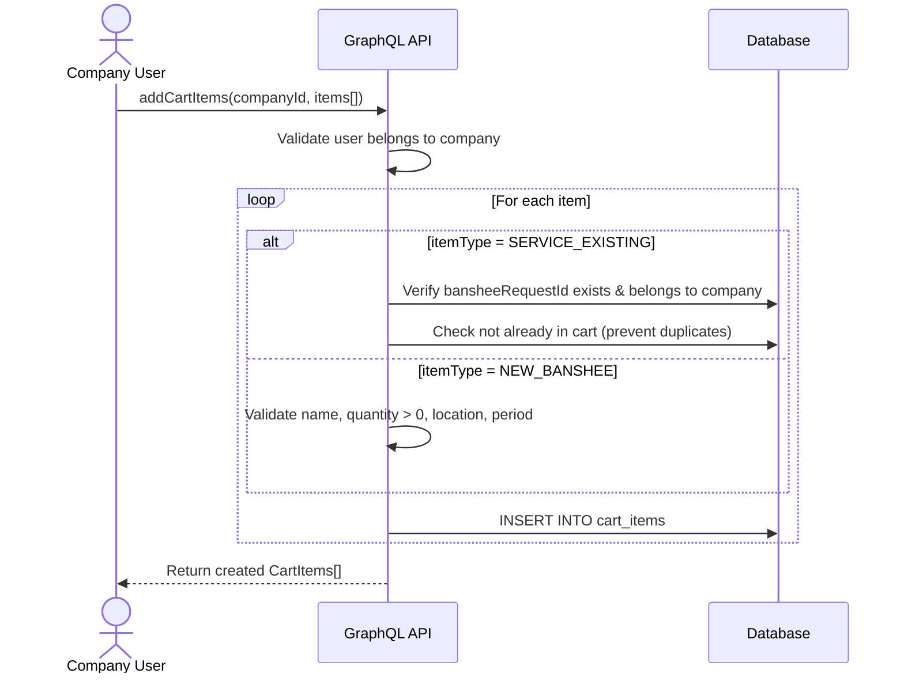
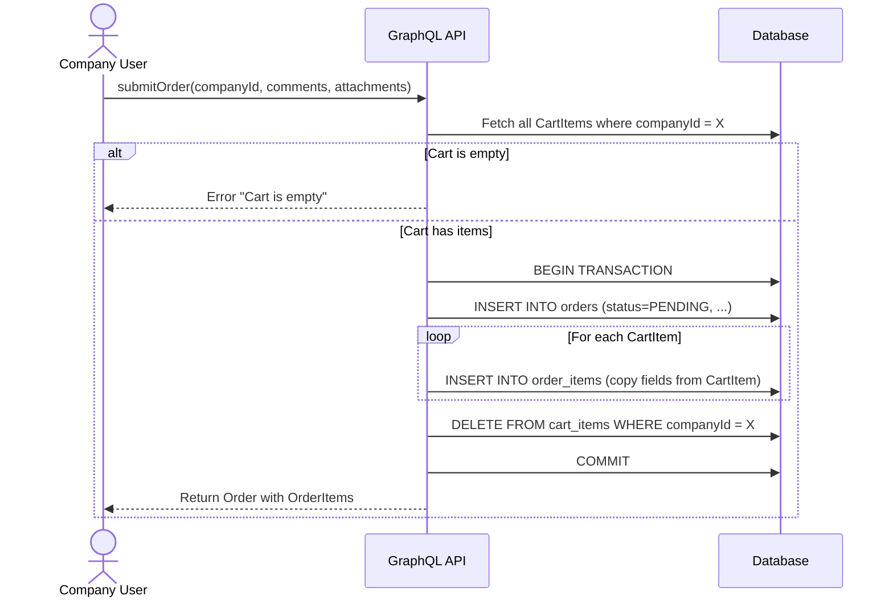
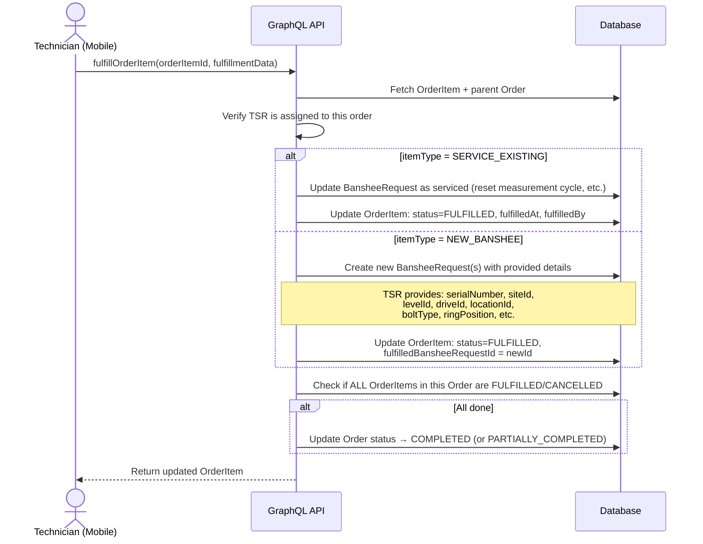
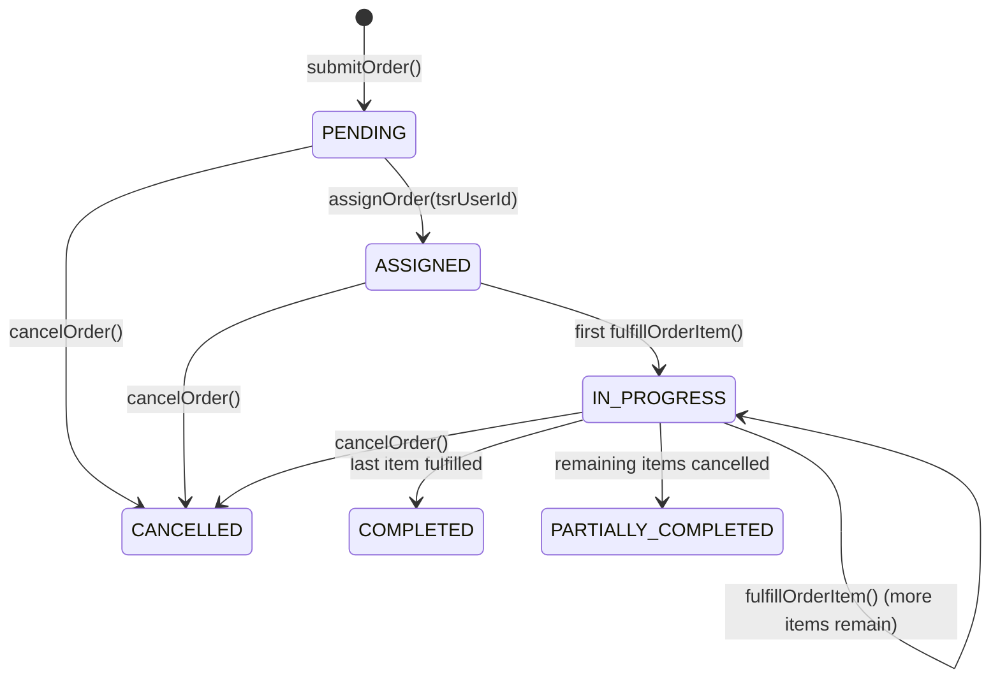
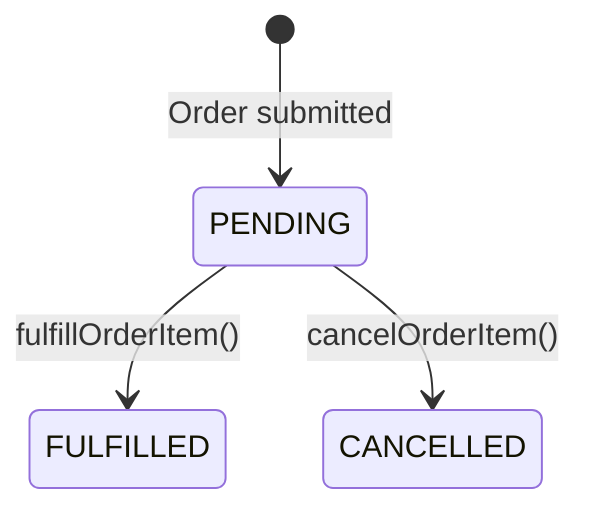

Banshee Scheduler → Cart → Order → Fulfillment: Backend Design

1. Overview
This document defines the backend architecture for the Banshee scheduling workflow — from a Company User selecting/creating banshees in the Scheduler, adding them to a Cart, submitting an Order, and a Sandvik Technician fulfilling that Order via the mobile app.

2. High-Level Flow:-
Step 1: Add Banshee / Service Selection
•	The user navigates to the Scheduler page and clicks on “Add New Banshee.” 
•	Within the Scheduler: 
o	For a new Banshee request: 
	The user provides the following details: 
	Name 
	Quantity 
	Location 
	Period 
o	For servicing an existing Banshee: 
	The user selects one or more existing Banshees using checkboxes. 
 
Step 2: Add to Cart
•	After making the required selection, the user clicks on “Add to Cart.” 
•	The system stores the entry in the CartItem table, mapped to the respective companyId. 
 
Step 3: Cart Management
•	The cart represents all CartItems associated with a company. 
•	Within the Cart: 
o	Users can review all added items. 
o	If the user clicks Delete, the selected item is removed from the CartItem table. 
 
Step 4: Order Submission
•	When the user submits the cart: 
o	A new Order is created. 
o	All CartItems are converted into OrderItems. 
o	The cart is effectively cleared (or reset at the application level). 
 
Step 5: TSR Workflow (Execution Layer)
•	The submitted order becomes visible to the TSR  via the mobile application. 
•	The TSR: 
o	Reviews assigned orders 
o	Performs required actions: 
	Registers new Banshees in the system 
	Services existing Banshees 
 
Step 6: Order Fulfillment
•	As the TSR completes tasks: 
o	Each OrderItem is marked as FULFILLED 
o	Relevant data (e.g., generated BansheeRequest) is linked back to the system 
•	Once all items are processed: 
o	The Order status is updated accordingly: 
	COMPLETED (all fulfilled) 
	PARTIALLY_COMPLETED (partial fulfillment)
 

3. Recommended Approach: Separate Cart, Order & OrderItem Tables
Why not a status field on one table?
Approach	Pros	Cons
Single table with status (cart → order via status flip)	Simpler schema	Loses cart semantics (add/remove freely). Mixing transient cart state with permanent order history. Hard to support "one active cart + many past orders" per company.
Separate Cart + Order tables 	Clean separation of concerns. Cart is ephemeral & editable. Orders are immutable audit records. Easy to query "pending orders for TSR." Multiple orders over time.	Slightly more schema, but maps directly to the real-world flow.

4. Database Schema Design
// ───────────────── ENUMS ─────────────────

enum CartItemType {
  NEW_BANSHEE
  SERVICE_EXISTING
}

enum OrderStatus {
  PENDING
  COMPLETED
  PARTIALLY_COMPLETED
  CANCELLED
}

enum OrderItemStatus {
  PENDING
  FULFILLED
  CANCELLED
}

// ───────────────── MODELS ─────────────────

model CartItem {
  id        String       @id @default(uuid())
  createdAt DateTime     @default(now())
  updatedAt DateTime     @updatedAt

  itemType  CartItemType

  // SERVICE_EXISTING
  bansheeRequestId  String?

  // NEW_BANSHEE
  name              String?
  quantity          Int         @default(1)
  location    String?
  period            Int?

  // Common
  company           Company     @relation(fields: [companyId], references: [id], onDelete: Cascade)
  companyId         String

  bansheeRequest    BansheeRequest? @relation(fields: [bansheeRequestId], references: [id], onDelete: SetNull)

  @@index([companyId])
  @@map("cart_items")
}

model Order {
  id        String      @id @default(uuid())
  createdAt DateTime    @default(now())
  updatedAt DateTime    @updatedAt

  status    OrderStatus @default(PENDING)
  attachments  string[]
  comment 	string
  company   Company     @relation(fields: [companyId], references: [id], onDelete: Cascade)
  companyId String

  orderItems OrderItem[]

  @@index([companyId])
  @@index([status])
  @@map("orders")
}

model OrderItem {
  id        String          @id @default(uuid())
  createdAt DateTime        @default(now())
  updatedAt DateTime        @updatedAt

  itemType  CartItemType
  status    OrderItemStatus @default(PENDING)

  // Shared (existing OR fulfilled new banshee)
  bansheeRequestId  String?

  // NEW_BANSHEE
  name              String?
  quantity          Int       @default(1)
  location   String?
  period            Int?

  // Relations
  order             Order     @relation(fields: [orderId], references: [id], onDelete: Cascade)
  orderId           String

  bansheeRequest    BansheeRequest? @relation(fields: [bansheeRequestId], references: [id], onDelete: SetNull)

  @@index([orderId])
  @@index([status])
  @@map("order_items")
}

// ───────────────── RELATION EXTENSIONS ─────────────────

model Company {
  // existing fields...

  cartItems CartItem[]
  orders    Order[]
}

model BansheeRequest {
  // existing fields...

  cartItems  CartItem[]
  orderItems OrderItem[]
}
5. Entity Relationship Diagram
 
 
6. GraphQL API Design
6.1 Cart Mutations (Company User — Web App)
Mutation	Purpose	Input
addCartItems	Add selected existing banshees OR new banshee batch to cart	companyId, items: [{ itemType, bansheeRequestId?, name?, quantity?, locationl?, period? }]
deleteCartItem	Remove a single item from cart	cartItemId
clearCart	Remove all items from the cart	companyId

6.2 Cart Queries (Company User — Web App)
Query	Purpose	Input
cartItems	Fetch all cart items for a company	companyId
6.3 Order Mutations
Mutation	Purpose	Caller	Input
submitOrder	Convert cart → order. Creates Order + OrderItems, clears cart.	Company User	companyId, 
cancelOrder	Cancel an entire pending order	Company User	orderId
fulfillOrderItem	Mark a single order item as fulfilled. For NEW_BANSHEE, also creates the BansheeRequest.	TSR (Mobile App)	orderItemId, 
cancelOrderItem	Cancel a single item within an order	TSR / Admin	orderItemId

6.4 Order Queries (TSR — Mobile App)
Query	Purpose	Input
orders	List orders (filterable by status, companyId)	status?, companyId?,
order	Get single order with all items	orderId

7. Cart Table — Field Summary
Field	Type	Description
id	UUID	Primary key
createdAt	DateTime	Auto
updatedAt	DateTime	Auto
itemType	CartItemType	NEW_BANSHEE or SERVICE_EXISTING
bansheeRequestId	UUID?	FK to existing BansheeRequest
name	String?	Batch name / label
quantity	Int	Default 1. For new banshees can be > 1
location	String?	Free-text location (not yet a real Location record)
period	Int?	Measurement period (days)
companyId	UUID	FK to Company

8. Order Table — Field Summary
Field	Type	Description
id	UUID	Primary key
createdAt	DateTime	Submission timestamp
updatedAt	DateTime	Auto
status	OrderStatus	Default PENDING
companyId	UUID	FK to Company
attachments	String[]	Attachments from user
comment	String	Additional comment
orderItems	[]	orderItems[]

9. OrderItem Table — Field Summary
Field	Type	Description
id	UUID	Primary key
createdAt	DateTime	Auto
updatedAt	DateTime	Auto
itemType	CartItemType	NEW_BANSHEE or SERVICE_EXISTING
status	OrderItemStatus	Default PENDING
bansheeRequestId	UUID?	FK to BansheeRequest being serviced
name	String?	Snapshot from cart
quantity	Int	Snapshot from cart
location	String?	Snapshot from cart
period	Int?	Snapshot from cart
orderId	UUID	FK to parent Order

## 7. Detailed Mutation Flows

### 7.1 `addCartItems`

### 7.2 `submitOrder`

### 7.3 `fulfillOrderItem` (TSR Mobile App)

---

## 8. State Machine: Order Lifecycle

---

7. Cart Table — Field Summary
Field	Type	Description
id	UUID	Primary key
createdAt	DateTime	Auto
updatedAt	DateTime	Auto
itemType	CartItemType	NEW_BANSHEE or SERVICE_EXISTING
bansheeRequestId	UUID?	FK to existing BansheeRequest
name	String?	Batch name / label
quantity	Int	Default 1. For new banshees can be > 1
location	String?	Free-text location (not yet a real Location record)
period	Int?	Measurement period (days)
companyId	UUID	FK to Company

8. Order Table — Field Summary
Field	Type	Description
id	UUID	Primary key
createdAt	DateTime	Submission timestamp
updatedAt	DateTime	Auto
status	OrderStatus	Default PENDING
companyId	UUID	FK to Company
attachments	String[]	Attachments from user
comment	String	Additional comment
orderItems	[]	orderItems[]

9. OrderItem Table — Field Summary
Field	Type	Description
id	UUID	Primary key
createdAt	DateTime	Auto
updatedAt	DateTime	Auto
itemType	CartItemType	NEW_BANSHEE or SERVICE_EXISTING
status	OrderItemStatus	Default PENDING
bansheeRequestId	UUID?	FK to BansheeRequest being serviced
name	String?	Snapshot from cart
quantity	Int	Snapshot from cart
location	String?	Snapshot from cart
period	Int?	Snapshot from cart
orderId	UUID	FK to parent Order

---