# Proceq Integration & Banshee Stats — Technical Design Document

**Purpose:** Synchronize bolt measurement data from the Proceq cloud API into the Ground Support Platform database, compute bolt elongation & status, track daily session statistics, and serve analytics via GraphQL. Power the Banshee scheduling pipeline (Template → Request → Cart → Order → Fulfilment) end-to-end.

**Modules:** `apps/api/src/proceq`, `apps/api/src/banshee-stats`, `apps/api/src/banshee-template`, `apps/api/src/banshee-request`, `apps/api/src/banshee-cart`, `apps/api/src/banshee-order`

---

## Table of Contents

1. [Overview](#1-overview)
2. [Architecture Diagram](#2-architecture-diagram)
3. [Module Structure](#3-module-structure)
4. [DB Diagram](#4-db-diagram)
5. [Proceq Module — Detailed Breakdown](#5-proceq-module--detailed-breakdown)
6. [Detailed Technical Breakdown](#6-detailed-technical-breakdown)
7. [Banshee Stats Module — Detailed Breakdown](#7-banshee-stats-module--detailed-breakdown)
8. [Sync Flow — Full Walkthrough](#8-sync-flow--full-walkthrough)
9. [Data Extraction Logic](#9-data-extraction-logic)
10. [Elongation & Status Calculation](#10-elongation--status-calculation)
11. [BansheeEventLog — Status Change Tracking](#11-bansheeeventlog--status-change-tracking)
12. [Banshee Request Mapping](#12-banshee-request-mapping)
13. [Attachment Processing](#13-attachment-processing)
14. [Raw Data Storage](#14-raw-data-storage)
15. [Environment Variables](#15-environment-variables)
16. [TypeScript Interfaces & DTOs](#16-typescript-interfaces--dtos)
17. [Error Handling & Resilience](#17-error-handling--resilience)
18. [Module Structure (New)](#18-module-structure-new)
19. [End-to-End Pipeline — High-Level Flow](#19-end-to-end-pipeline--high-level-flow)
20. [Updated Database Schema (ERD)](#20-updated-database-schema-erd)
21. [Banshee Template Module — Detailed Breakdown](#21-banshee-template-module--detailed-breakdown)
22. [Banshee Request Module — Detailed Breakdown](#22-banshee-request-module--detailed-breakdown)
23. [Banshee Cart Module — Detailed Breakdown](#23-banshee-cart-module--detailed-breakdown)
24. [Banshee Order Module — Detailed Breakdown](#24-banshee-order-module--detailed-breakdown)
25. [RBAC — Role-Based Access Control](#25-rbac--role-based-access-control)
26. [End-to-End Walkthrough](#26-end-to-end-walkthrough)

---

## 1. Overview

The Proceq module integrates with the Proceq Workspace Cloud API (Screening Eagle) to automatically pull ultrasonic bolt measurement data from field devices (FDL instruments) into the Ground Support Platform. This data powers the Banshee bolt management workflow.

The Banshee Stats module aggregates measurement data into daily session statistics that track total measurements, broken bolts, and not-measurable bolts per day — grouped by company.

### 1.1 What Problem Does This Solve?

Field technicians take bolt measurements using Proceq FDL ultrasonic devices. These measurements are uploaded to the Proceq cloud. Our platform needs to:

- Pull those measurements automatically (every 5 minutes)
- Extract useful fields (readings, comments, temperatures, photos)
- Link each measurement to the correct `BansheeRequest` (work order) by matching serial numbers
- Compute bolt elongation and classify bolts as Elastic / Low Plastic / High Plastic
- Track daily statistics (how many bolts measured, broken, not measurable)
- Store raw data + photo attachments on disk
- Log status change events per `BansheeRequest` for audit & history

---

## 2. Architecture Diagram

### 2.1 High-Level System Overview

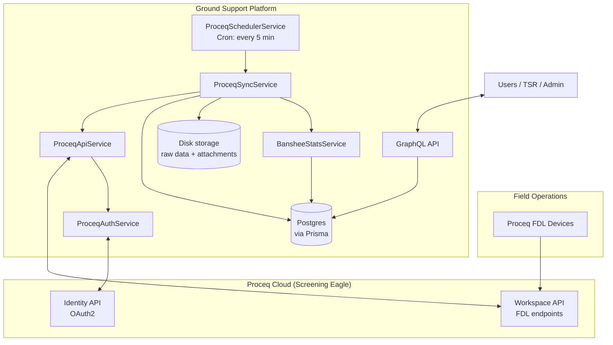

### 2.2 Data Flow — Storage Access Map

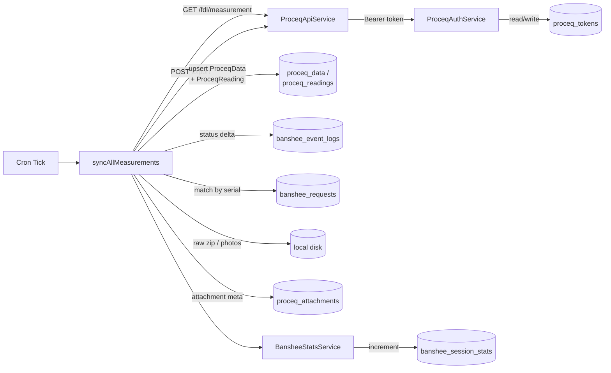

---

## 3. Module Structure

### Proceq Module (`apps/api/src/proceq/`)

| File | Role | Lines |
|---|---|---|
| `proceq.module.ts` | NestJS module registration | 24 |
| `proceq-auth.service.ts` | OAuth2 authentication & token management | 255 |
| `proceq-auth.controller.ts` | REST endpoints for login & OAuth callback | 49 |
| `proceq-api.service.ts` | HTTP client wrapping Proceq API calls | 127 |
| `proceq-sync.service.ts` | Core sync engine — extraction, upsert, status computation | 1,103 |
| `proceq-scheduler.service.ts` | Cron-based trigger for sync | 30 |
| `proceq.graphql` | GraphQL type definitions | 70 |
| `dto/proceq-token.dto.ts` | Token DTO class | 5 |
| `interfaces/proceq-sync.interfaces.ts` | Core data interfaces | 146 |
| `interfaces/proceq-measurement.interface.ts` | Measurement type definitions | 41 |
| `interfaces/proceq-config.interface.ts` | Config interface | 10 |

### Banshee Stats Module (`apps/api/src/banshee-stats/`)

| File | Role | Lines |
|---|---|---|
| `banshee-stats.module.ts` | NestJS module registration | 11 |
| `banshee-stats.service.ts` | Stats aggregation logic | 159 |
| `banshee-stats.resolver.ts` | GraphQL query/mutation resolver | 45 |
| `banshee-stats.graphql` | GraphQL type definitions | 43 |

---

## 4. DB Diagram

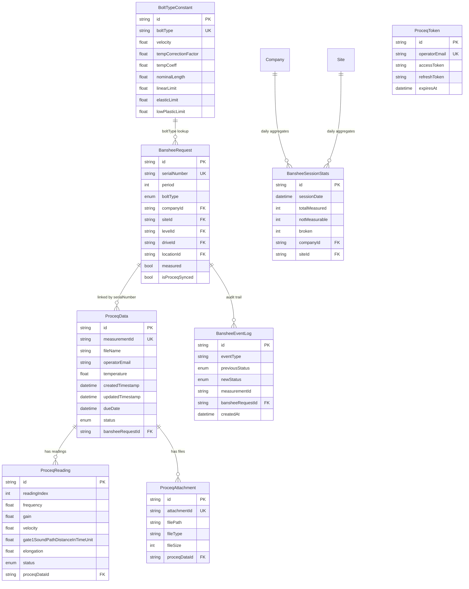

---

## 5. Proceq Module — Detailed Breakdown

### 5.1 Authentication Flow (`proceq-auth.service.ts`)

Handles OAuth 2.0 Authorization Code flow with the Proceq Identity API.

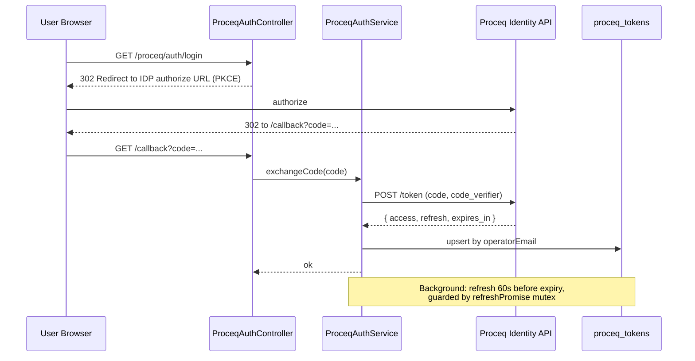

#### Key Details

| Aspect | Detail |
|---|---|
| OAuth flow | Authorization Code grant with PKCE |
| Token storage | `proceq_tokens` table, keyed by `operatorEmail` |
| Auto-refresh | Token is refreshed 60 seconds before expiry |
| Concurrency safety | Mutex via `refreshPromise` prevents parallel refresh calls |
| Startup behaviour | On module init, loads token from DB if still valid |
| Scopes | `openid email profile offline` |
| Current operator | Hardcoded to `osvaldo.vallati@sandvik.com` (will be made dynamic) |

### 5.2 API Client (`proceq-api.service.ts`)

Thin HTTP wrapper over the Proceq Workspace API. Uses Axios with automatic auth-header injection and retry logic.

#### Available API Methods

| Method | Endpoint | Description |
|---|---|---|
| `getMeasurements(page, size)` | `GET /fdl/measurement?page=&size=` | List measurements (paginated) |
| `getMeasurementDetails(id)` | `GET /fdl/measurement/{id}` | Single measurement details |
| `getMeasurementAttachments(id)` | `GET /fdl/measurement/{id}/attachment` | List attachments for a measurement |
| `downloadAttachment(mId, aId)` | `GET /fdl/measurement/{mId}/attachment/{aId}/download` | Download attachment binary |
| `exportMeasurementData(ids, format)` | `POST /fdl/measurement/export` | Request bulk JSON export |
| `getExportStatus(exportId)` | `GET /fdl/measurement/export/{id}/status` | Poll for export readiness |

#### Retry Logic

- Max 1 retry (`MAX_RETRIES = 1`)
- Delay: 1 second × attempt number (linear backoff)
- On failure, re-authenticates before retry

### 5.3 Sync Service (`proceq-sync.service.ts`)

This is the heart of the integration — 1,100+ lines handling the full data sync pipeline.

#### Core Constants

| Constant | Value | Purpose |
|---|---|---|
| `MAX_BATCH_SIZE` | 100 | Max measurements per export request |
| `EXPORT_POLL_INTERVAL` | 3,000 ms | How often to poll export status |
| `EXPORT_TIMEOUT` | 300,000 ms (5 min) | Max wait for an export to complete |

#### 5.3.1 Public Method: `syncAllMeasurements()`

This is the single entry point called by the scheduler. Returns a `SyncResult`:

```ts
interface SyncResult {
  success: boolean;       // true if zero failed batches
  duration: number;       // total time in ms
  totalScanned: number;   // measurements checked from API
  newMeasurements: number;
  updatedMeasurements: number;
  failedBatches: number;
}
```

#### Private Methods Summary

| Method | Purpose |
|---|---|
| `extractProceqFields()` | Parse JSON payload into `ExtractedProceqFields` |
| `processMeasurementsBatch()` | Export → download → process archive for a batch |
| `processAttachments()` | Download & save photos/audio for measurements |
| `getFileType()` | Classify file extension as image / audio / other |
| `saveAttachment()` | Decompress attachment ZIP and save media files |
| `processExportArchive()` | Main extraction pipeline — parse JSONs, map to `BansheeRequest`, compute status |
| `bulkUpsertProceqData()` | Transactional upsert of `ProceqData` + `ProceqReading` rows + insert into `bansheeEventLog` if any status changes |
| `updateStatsForNewRecords()` | Push measurement counts to `BansheeStatsService` |
| `saveRawDataAsZip()` | Compress raw measurement data to ZIP file on disk |
| `computeStatusForRecords()` | Calculate elongation & bolt status (Elastic / Plastic) |

### 5.4 Scheduler (`proceq-scheduler.service.ts`)

Simple cron trigger using NestJS `@Cron` decorator.

| Setting | Value |
|---|---|
| Cron expression | `0 */2 * * * *` (every 2 minutes) |
| Action | Calls `syncService.syncAllMeasurements()` |
| Skip logic | If sync is already running, returns immediately |

### 5.5 Auth Controller (`proceq-auth.controller.ts`)

REST endpoints for initiating and completing OAuth.

| Route | Method | What it does |
|---|---|---|
| `/proceq/auth/login` | GET | Redirects browser to Proceq login page |
| `/callback` | GET | Receives authorization code from Proceq, exchanges for tokens |

### 5.6 GraphQL Schema (`proceq.graphql`)

Defines three types exposed via GraphQL:

- **`ProceqData`** — Parent measurement record with fields like `measurementId`, `fileName`, `status`, `temperature`, etc.
- **`ProceqReading`** — Individual reading with UT parameters (frequency, gain, voltage, gate values, elongation)
- **`ProceqAttachment`** — File attachment metadata (path, type, size)

---

## 6. Detailed Technical Breakdown

### 6.1 Scheduled Trigger — `proceq-scheduler.service.ts`

| Item | Detail |
|---|---|
| Cron | `0 */5 * * * *` — every 5 minutes |
| Guard | `isSyncing` flag prevents overlapping runs |
| Entry point | Calls `syncAllMeasurements()` |

**Non-technical:** A timer runs every 5 minutes. If a previous sync is still running, it skips.

### 6.2 `syncAllMeasurements()` — Lines 214–345

**Non-technical:** Goes through ALL measurements in Proceq's cloud, page by page, and figures out which ones are brand new (not yet in our database). Then it processes the new ones in batches.

**Technical flow:**

1. Calls `api.getMeasurements(1, 1)` to get total count + pagination info
2. Loops through every page (100 per page), collecting all measurement IDs
3. For each page, queries our DB for existing `proceqData` records → filters to only new IDs
4. Batch size = 100
5. Calls `processMeasurementsBatch()` for each batch
6. Returns a `SyncResult` with success / duration / counts / failed batches

### 6.3 `processMeasurementsBatch()` — Lines 347–402

**Non-technical:** Takes a group of measurement IDs, asks Proceq to prepare a downloadable export file, waits for it to be ready, then downloads and processes it.

**Technical flow:**

1. Calls `api.exportMeasurementData(ids, 'json')` → gets an `exportId`
2. Polling loop: every 3 seconds, checks `api.getExportStatus(exportId)`
3. Timeout after 5 minutes (`EXPORT_TIMEOUT = 300000ms`)
4. On `'completed'` → downloads the archive and calls `processExportArchive()`
5. On `'failed'` → throws error
6. After archive is processed, kicks off background attachment processing via `setImmediate()` (non-blocking)

### 6.4 `processExportArchive()` — Lines 561–765

This is the core function — the brain of the sync.

**Non-technical:** Opens the downloaded zip, reads each measurement's JSON file, extracts the important fields, matches each measurement to a bolt order (`BansheeRequest`), runs math calculations, and saves everything to the database.

**Step 4a — Parse the archive structure**

- Reads the extracted directory for folders starting with `JSON_`
- Scans each subdirectory to find JSON files
- Reads the first JSON in each folder to extract the `measurementId` and `fileName`
- Builds a `measurementDirMap` (Map of ID/filename → directory path) for quick lookup

**Step 4b — Extract data from each measurement**

- For each `measurementId` passed in, looks up the directory in the map
- Reads the JSON file and calls `extractProceqFields()`
- Saves raw data as zip if present (via `saveRawDataAsZip()`)
- Tracks the `baseFileName` (serial number) for matching with Banshee

**Step 4c — Match to BansheeRequest**

- Collects all unique `baseFileName` values (these are the serial numbers)
- Queries DB: `bansheeRequest.findMany({ where: serialNumber IN [...] })`
- For each match, links the record via `bansheeRequestId`
- Records which `bansheeRequestIds` to mark as synced

**Step 4d — Compute status & elongation**

- Fetches `BoltTypeConstant` records from DB based on bolt types found
- Calls `computeStatusForRecords()` — the calculation engine

**Step 4e — Save to DB**

- Calls `updateStatsForNewRecords()` — updates operator/company statistics
- Calls `bulkUpsertProceqData()` — saves all `ProceqData` + `ProceqReading` rows
- Marks matched `BansheeRequest` records as `isProceqSynced = true`

### 6.5 `extractProceqFields()` — Lines 36–212

**Non-technical:** Takes the raw JSON from Proceq and picks out all the important fields — sensor settings, measurement results, user comments, photos, and timestamps.

| What | How it's extracted |
|---|---|
| Comment | From `logs` → `type 'userText'` → `content.comment` |
| Photos | From `logs` → `type 'userPhoto'` → `content.attachmentId/Name` |
| Timestamps | From `logs` → `type 'probe'` → `created/updated` fields |
| Temperature | Parsed from comment text via regex: `temperature[\s:=]*(-?\d+(\.\d+)?)` |
| Settings | From `settings[0].content.indicationStatus.measurementSetupFile` |
| Readings | From `readings[]` array, each with setup file + `toolBarOptions` |
| File name | `measurement.content.info.fileName` or `measurement.name` — made unique by appending timestamp |

Handles two JSON formats: Proceq API response format (`data.measurement.xxx`) and raw export format (`measurement.xxx`).

If there are no readings, creates a single placeholder reading from the settings data (with null measurement values).

For each reading, extracts:

- **Sensor config:** `frequency, gain, voltage, damping, analogueFilter, sampleAveraging, zeroOffset, velocity`
- **Gate1 config:** `level, measurementLevel, referenceSamplingRate, start, width`
- **Results:** `gate1MaximumAmplitude, gate1SoundPathDistance, gate1SoundPathDistanceInTimeUnit`
- **`elongation`** — initially set to `null`, calculated later

> **IMPORTANT** — Temperature extraction is comment-based only. If the operator doesn't write `"temperature XX"` in the comment, `temperature` will be `null` and the calculation will be skipped for that record.

### 6.6 `bulkUpsertProceqData()` — Lines 767–881

**Non-technical:** Saves all the measurement data to the database. If a record already exists, it updates it; if not, it creates it. Additionally, it tracks when a measurement's status changes (e.g., from "Elastic" to "High plastic") and logs that change as an event for audit purposes.

**Technical details:**

- Processes in chunks of 50 to avoid overwhelming the DB
- **Pre-upsert snapshot:** before upserting each chunk, fetches existing records' status and `bansheeRequestId` into an `existingStatusMap` for later comparison
- **Two-phase upsert:**
  - **Parent records (`ProceqData`):** upserts by `measurementId` with all top-level fields including `status`, `bansheeRequestId`
  - **Child records (`ProceqReading`):** upserts by composite key `(proceqDataId, readingIndex)` with all reading fields including `elongation` and `status`
- Both phases run inside a `$transaction` for data integrity
- **Event log creation (post-upsert):** after the upsert, iterates through the chunk and compares each record's new status against the old status from `existingStatusMap`. If:
  - the record previously existed with a `bansheeRequestId`, **and**
  - both old and new statuses are non-null, **and**
  - the status changed —

  then a `STATUS_CHANGE` event is pushed to an `eventLogs` array with `eventType, previousStatus, newStatus, measurementId, bansheeRequestId`, and `createdAt` (set to the record's `updatedTimestamp`). These are bulk inserted via `prisma.bansheeEventLog.createMany()`.

### 6.7 `computeStatusForRecords()` — Lines 956–1064

**Non-technical:** This is the math engine. For each bolt reading, it calculates how much the bolt has stretched (elongation) and classifies it as Elastic (safe), Low Plastic (watch), or High Plastic (danger).

**Pre-check — Comment-based statuses:**

| Comment contains | Status set | Skips calculation? |
|---|---|---|
| `"broken"` | `broken` | Yes |
| `"not measurable"` | `not measurable` | Yes |

**Main calculation (per reading):**

Only runs if both `temperature` and `gate1SoundPathDistanceInTimeUnit` are not null.

**Step 1 — Calculate physical length L_UT**

```
L_UT = (gate1SoundPathDistanceInTimeUnit × velocity / 2) × 1000
```

Converts ultrasonic time-of-flight to a physical distance in mm using the bolt material's sound velocity.

**Step 2 — Temperature correction → L_UT_T**

```
L_UT_T = L_UT × tempCorrectionFactor × (1 + (tempCoeff × (20 − temp)) / 10^6)
```

Adjusts for thermal expansion/contraction relative to reference temp of 20°C.

> **WARNING — Pending: Empty temperature handling.** If `record.temperature` is null (no temperature in user comment), the calculation is skipped for that record. Proper handling of missing temperature / temperature from user comments is still pending.

**Step 3 — Calculate elongation E_LUT_T_L**

```
diff = L_UT_T − nominalLength (L0)
If diff ≤ linearLimit:
    E_LUT_T_L = quadCoeff1 × diff² + linCoeff1 × diff
Else:
    E_LUT_T_L = quadCoeff2 × diff² + linCoeff2 × diff − constTerm
```

Uses a piecewise quadratic formula — different coefficients below vs above the `linearLimit`. All constants come from the `BoltTypeConstant` DB table, specific to the bolt type.

**Step 4 — Classify status based on elongation**

| Condition | Status |
|---|---|
| `E_LUT_T_L < elasticLimit` | Elastic (safe) |
| `E_LUT_T_L ≤ lowPlasticLimit` | Low Plastic (watch) |
| `E_LUT_T_L > lowPlasticLimit` | High Plastic (danger) |

**Step 5 — Assign results**

- Each reading gets its computed elongation and status
- The parent record's status is set to the status of the last reading (sorted by index)

### 6.8 `processAttachments()` — Lines 404–486

**Non-technical:** Downloads any photos or audio files the operator attached to measurements and saves them locally.

**Technical details:**

- Runs in background (non-blocking via `setImmediate`)
- Processes 5 measurements concurrently
- For each measurement:
  - Fetches attachment list from Proceq API
  - Downloads each attachment as binary buffer
  - Decompresses (Proceq sends them as archives)
  - Filters for supported formats (images: png/jpg/gif/etc., audio: mp3/wav/etc.)
  - Saves to `proceq-data/attachments/{measurementId}/`
  - Upserts `ProceqAttachment` record in DB

### 6.9 `updateStatsForNewRecords()` — Lines 883–924

**Non-technical:** Updates internal statistics (operator performance, company metrics) whenever new measurements are synced.

**Technical:** Looks up the `companyId` from the banshee request matched to each measurement's serial number, then calls `statsService.updateStatsForMeasurement()` in batches of 5.

---

## 7. Banshee Stats Module — Detailed Breakdown

### 7.1 Stats Service (`banshee-stats.service.ts`)

Aggregates measurement data into daily summaries stored in `banshee_session_stats`.

| Method | What it does |
|---|---|
| `updateStatsForMeasurement()` | Increment daily counters (measured, broken, not measurable) for a given date |
| `getDailyStats()` | Get stats for a specific operator + date |
| `getStatsForPeriod()` | Get stats in a date range, optionally filtered by operator or company |
| `generateDailyReport()` | Get all stats for a date with company info (includes relation) |

### 7.2 Comment Classification Logic

The service classifies comments to detect bolt status:

| Category | Keywords matched |
|---|---|
| Not Measurable | `"not measurable"`, `"cannot measure"`, `"unable to measure"` |
| Broken | `"broken"`, `"damage"`, `"fault"`, `"defect"`, `"temperature" + "error"` |

### 7.3 Stats Update Flow

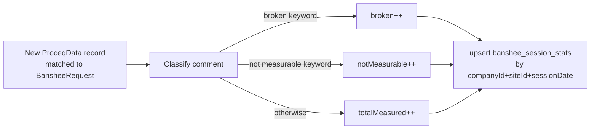

### 7.4 Resolver (GraphQL API) — `banshee-stats.resolver.ts`

Protected by `JwtGuard + RolesGuard`. Exposes:

| Query / Mutation | Arguments | Returns |
|---|---|---|
| `dailyStats` | `operatorEmail, date` | Single `BansheeSessionStats` |
| `statsForPeriod` | `startDate, endDate, operatorEmail?, companyId?` | Array of `BansheeSessionStats` |
| `dailyReport` | `date` | Array of `DailyReportEntry` (with company) |
| `generateDailyReport` (Mutation) | `date` | Success message string |

### 7.5 GraphQL Schema (`banshee-stats.graphql`)

Defines two types:

- **`BansheeSessionStats`** — `sessionDate, totalMeasured, notMeasurable, broken`, linked `Company`
- **`DailyReportEntry`** — same fields, used for report responses

---

## 8. Sync Flow — Full Walkthrough

This is the complete end-to-end flow when the cron job fires:

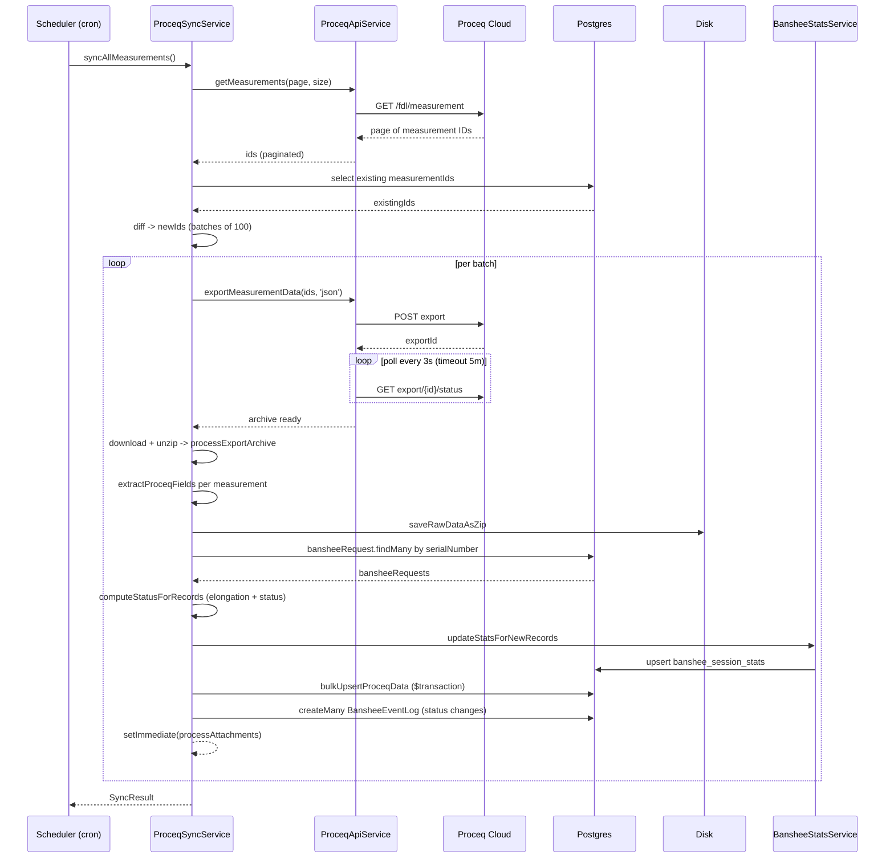

---

## 9. Data Extraction Logic

The `extractProceqFields()` method parses JSON payloads from the Proceq export. The JSON can come in two shapes.

### Format Detection

| Format | Condition | Measurement path |
|---|---|---|
| API Response | `payload.data` exists | `payload.data.measurement` |
| Export File | `payload.data` absent | `payload.measurement` |

### Fields Extracted

| Field | Source | Notes |
|---|---|---|
| `measurementId` | `measurement.id` | Unique Proceq ID |
| `fileName` | `measurement.content.info.fileName` or `measurement.name` | Appended with `_createdTimestamp` later |
| `operatorEmail` | `measurement.content.info.email` | Who took the measurement |
| `comments` | `logs[type="userText"].content.comment` | Free-text comment from operator |
| `temperature` | Parsed from `comments` via regex | Pattern: `temperature[\s:=]*(-?\d+(\.\d+)?)` |
| `userPhoto` | `logs[type="userPhoto"]` | Array of `{attachmentId, attachmentName}` |

### Per-Reading Fields

| Field | Source | Notes |
|---|---|---|
| `readingIndex` | Array position | 0-based |
| `indicationSetupFileName` | `reading.content.indicationSetupFile.name` | Falls back to settings-level value |
| `measuringMode, frequency, gain, voltage, …` | From reading's setup file | Falls back to settings |
| `gate1SoundPathDistanceInTimeUnit` | `reading.content.indicationSettings.toolBarOptions` | Critical for elongation calc |
| `rawData` | `reading.rawData` | Saved as compressed ZIP |

### Fallback Logic

Each reading-level field has a fallback chain:

1. Reading's own `indicationSetupFile`
2. Measurement-level `settings[0].content.indicationStatus.measurementSetupFile`
3. `null`

---

## 10. Elongation & Status Calculation

### Calculation Steps

```mermaid
flowchart TD
    R[Reading] --> Pre{Comment pre-check}
    Pre -->|contains "broken"| Sb[status = broken<br/>skip math]
    Pre -->|contains "not measurable"| Sn[status = not measurable<br/>skip math]
    Pre -->|none| Inputs{temperature AND<br/>gate1SoundPathDistanceInTimeUnit<br/>both present?}
    Inputs -->|No| Skip[skip calculation,<br/>elongation = null]
    Inputs -->|Yes| L1[L_UT = TOF × velocity / 2 × 1000]
    L1 --> L2[L_UT_T = L_UT × tempCorrectionFactor<br/>× (1 + tempCoeff × (20 − temp) / 10^6)]
    L2 --> L3{diff = L_UT_T − L0<br/>≤ linearLimit?}
    L3 -->|Yes| F1[E = quadCoeff1·diff² + linCoeff1·diff]
    L3 -->|No| F2[E = quadCoeff2·diff² + linCoeff2·diff − constTerm]
    F1 --> Cls{Classify E}
    F2 --> Cls
    Cls -->|E < elasticLimit| Se[Elastic]
    Cls -->|E ≤ lowPlasticLimit| Sl[Low Plastic]
    Cls -->|E > lowPlasticLimit| Sh[High Plastic]
```

### Special Comment-Based Status

Before computing elongation, comments are checked first:

| Comment contains | Status set to | Skips calculation? |
|---|---|---|
| `"broken"` | `broken` | Yes |
| `"not measurable"` | `not measurable` | Yes |

### Status Propagation

- Each reading gets its own status and elongation value
- The parent `ProceqData` record gets the status of the last reading (sorted by `readingIndex`)
- Default temperature is 32°C if not provided

### Bolt Constants (from `bolt_type_constants` table)

| Constant | Default value | Description |
|---|---|---|
| `velocity` | 5,890 m/s | Sound velocity in bolt material |
| `tempCorrectionFactor` | 1.0027 | Temperature correction multiplier |
| `tempCoeff` | 106 | Temperature coefficient |
| `nominalLength` (L0) | 2,300 mm | Expected bolt length |
| `linearLimit` | 50 mm | Threshold for linear vs quadratic formula |
| `elasticLimit` | 10 kN | Below = Elastic |
| `lowPlasticLimit` | 100 kN | Between elastic and this = Low Plastic |

---

## 11. BansheeEventLog — Status Change Tracking

The `BansheeEventLog` provides an immutable audit trail of status transitions for each `BansheeRequest`. During every Proceq sync cycle, when `bulkUpsertProceqData()` processes a chunk of measurements, it:

1. **Snapshots existing statuses** — before upserting, queries the current `proceq_data` table for each measurement's existing status and `bansheeRequestId`.
2. **Compares old vs new** — after upserting, compares each record's previous status against the newly computed status.
3. **Logs changes** — if the status has changed AND the measurement is linked to a `BansheeRequest`, a `BansheeEventLog` entry is created with `eventType = STATUS_CHANGE`.

Events are only created on re-syncs (when a measurement already existed), never on the first insert. The `createdAt` timestamp on the event log is taken from the measurement's `updatedTimestamp` (from the Proceq API), giving the actual time the status changed on the device.

### Event Flow

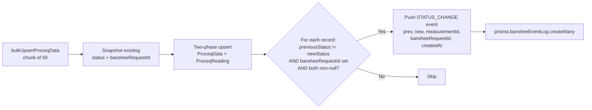

---

## 12. Banshee Request Mapping

Each measurement is linked to a `BansheeRequest` (work order) by matching `fileName` (serial number) with `BansheeRequest.serialNumber`.

### Important Detail — Multiple Readings per Serial

One `BansheeRequest.serialNumber` can match multiple measurements (e.g., repeated measurements at different times). All are linked via the `baseFileNameToRecordIndices` map.

```mermaid
flowchart LR
    Files[Set of unique baseFileNames<br/>extracted from archive] -->|findMany serialNumber IN [...]| BRs[BansheeRequests]
    BRs --> Map[baseFileNameToRecordIndices<br/>Map: serialNumber to indices]
    Map --> Link[For each index:<br/>recordsToUpsert idx .bansheeRequestId = BR.id]
    Link --> Sync[Mark BansheeRequest<br/>isProceqSynced = true]
```

---

## 13. Attachment Processing

Attachments (photos, audio recordings) are processed in the background after the main sync completes, using `setImmediate()`.

### Supported File Types

| Category | Extensions |
|---|---|
| Image | `png, jpg, jpeg, gif, bmp, webp, tiff, svg` |
| Audio | `mp3, wav, ogg, flac, aac, m4a, wma` |

---

## 14. Raw Data Storage

When a reading contains `rawData`, it's saved to disk:

1. Write JSON to `proceq-data/raw-data/{measurementId}_raw.json`
2. Compress to `proceq-data/raw-data/{measurementId}_raw.zip` (zlib level 9)
3. Store `rawDataZipPath` in the `ProceqData` record

For measurements with multiple readings, only the first reading's raw data path is stored on the parent record.

---

## 15. Environment Variables

| Variable | Required | Description |
|---|---|---|
| `PROCEQ_CLIENT_ID` | Yes | OAuth client ID from Proceq developer portal |
| `PROCEQ_CLIENT_SECRET` | Yes | OAuth client secret |
| `PROCEQ_REDIRECT_URI` | Yes | OAuth callback URL (must match `/callback` route) |
| `PROCEQ_WORKSPACE_DOMAIN` | Yes | Identity / auth domain (e.g., `workspace.2.proceq.com`) |
| `PROCEQ_REGIONAL_DOMAIN` | Yes | Regional API domain (e.g., `eu.2.proceq.com`) |
| `DATABASE_URL` | Yes | PostgreSQL connection string |

---

## 16. TypeScript Interfaces & DTOs

### `ProceqTokenDto`

```ts
class ProceqTokenDto {
  accessToken: string;
  expiresAt: number;     // Unix timestamp in ms
  refreshToken: string;
}
```

### `ExtractedProceqFields` — core data shape after extraction

```ts
interface ExtractedProceqFields {
  measurementId: string;
  fileName: string;              // serial + "_" + createdTimestamp
  operatorEmail: string | null;
  comments: string | undefined;
  temperature: number | null;    // Parsed from comments
  userPhoto: UserPhotoEntry[];
  createdTimestamp: bigint | null;
  updatedTimestamp: bigint | null;
  rawDataZipId: string | null;
  rawDataZipPath: string | null;
  readings: ExtractedProceqReading[];
  status?: string;               // Computed: "Elastic" | "Low plastic" | "High plastic" | "broken" | "not measurable"
}
```

### `ExtractedProceqReading`

```ts
interface ExtractedProceqReading {
  readingIndex: number;
  indicationSetupFileName: string | null;
  measuringMode: string | null;
  frequency: number | null;
  gain: number | null;
  voltage: number | null;
  sampleAveraging: number | null;
  damping: number | null;
  analogueFilter: number | null;
  zeroOffset: number | null;
  velocity: number | null;
  level: number | null;
  measurementLevel: number | null;
  referenceSamplingRate: number | null;
  start: number | null;
  width: number | null;
  gate1MaximumAmplitude: number | null;
  gate1SoundPathDistance: number | null;
  gate1SoundPathDistanceInTimeUnit: number | null;
  elongation: number | null;        // Computed
  status?: string;                   // Computed
}
```

### `BoltConstants`

```ts
interface BoltConstants {
  boltType: string;
  velocity: number;
  tempCorrectionFactor: number;
  tempCoeff: number;
  quadCoeff1: number;
  linCoeff1: number;
  quadCoeff2: number;
  linCoeff2: number;
  constTerm: number;
  nominalLength: number;
  linearLimit: number;
  elasticLimit: number;
  lowPlasticLimit: number;
}
```

### `SyncResult`

```ts
interface SyncResult {
  success: boolean;
  duration: number;
  totalScanned: number;
  newMeasurements: number;
  updatedMeasurements: number;
  failedBatches: number;
}
```

---

## 17. Error Handling & Resilience

| Mechanism | Where | How |
|---|---|---|
| Sync lock | `syncAllMeasurements()` | `isSyncing` flag prevents overlapping sync runs |
| Retry with backoff | `ProceqApiService.retryableGet()` | 1 retry with 1s × attempt delay |
| Export timeout | `processMeasurementsBatch()` | 5-minute timeout on export polling |
| Batch failure isolation | `syncAllMeasurements()` | Failed batches are logged and skipped; sync continues |
| Attachment isolation | `processAttachments()` | Runs in background via `setImmediate()`; failures don't block sync |
| Transactional upserts | `bulkUpsertProceqData()` | Parent records upserted in one transaction, then readings in another |
| Chunk size | `bulkUpsertProceqData()` | 50 records per transaction to avoid memory issues |
| Concurrency limits | `processAttachments()` | 5 concurrent downloads; `updateStatsForNewRecords()` uses 5 concurrent stat updates |
| Token refresh mutex | `ProceqAuthService` | Only one refresh in-flight at a time via `refreshPromise` |
| Graceful error extraction | `extractErrorMessage()` | Handles Axios errors, generic Error, and unknown types |

---

# Backend Updates — Scheduler / Cart / Order Pipeline

This section documents the modules introduced to power the end-to-end Banshee scheduling workflow: a Company User authors a service request via a Template, queues it as Cart Items, submits an Order, and a Sandvik Technician (TSR) fulfils each Order Item from the mobile application. All routes are protected by the unified RBAC layer.

## 18. Module Structure (New)

### Banshee Template Module (`apps/api/src/banshee-template/`)

| File | Role | Lines |
|---|---|---|
| `banshee-template.module.ts` | NestJS module registration | 8 |
| `banshee-template.service.ts` | Template CRUD + relation validation | 438 |
| `banshee-template.resolver.ts` | GraphQL resolver (RBAC-guarded) | 72 |
| `bansheeTemplate.graphql` | GraphQL type definitions | 69 |
| `dto/banshee-template.input.ts` | Input DTO with class-validator rules | 50 |

### Banshee Request Module (`apps/api/src/banshee-request/`)

| File | Role | Lines |
|---|---|---|
| `banshee-request.module.ts` | NestJS module registration | 11 |
| `banshee-request.service.ts` | Request lifecycle + status distribution | 884 |
| `banshee-request.resolver.ts` | GraphQL resolver (RBAC-guarded) | 244 |
| `bansheeRequest.graphql` | GraphQL type definitions | 225 |
| `dto/create-banshee-request.input.ts` | Create DTO | — |
| `dto/update-banshee-request.input.ts` | Update DTO | — |

### Banshee Cart Module (`apps/api/src/banshee-cart/`)

| File | Role | Lines |
|---|---|---|
| `banshee-cart.module.ts` | NestJS module registration | 9 |
| `banshee-cart.service.ts` | Cart CRUD + validation | 100 |
| `banshee-cart.resolver.ts` | GraphQL resolver (RBAC-guarded) | 38 |
| `banshee-cart.graphql` | GraphQL type definitions | 46 |
| `dto/add-cart-item.input.ts` | Polymorphic cart-item DTO | 39 |

### Banshee Order Module (`apps/api/src/banshee-order/`)

| File | Role | Lines |
|---|---|---|
| `banshee-order.module.ts` | NestJS module registration | 9 |
| `banshee-order.service.ts` | Order submission + fulfilment + status recompute | 279 |
| `banshee-order.resolver.ts` | GraphQL resolver (RBAC-guarded) | 74 |
| `banshee-order.graphql` | GraphQL type definitions | 79 |
| `dto/submit-order.input.ts` | Submit DTO | 14 |
| `dto/order-filter.input.ts` | Filter DTO | 18 |

---

## 19. End-to-End Pipeline — High-Level Flow

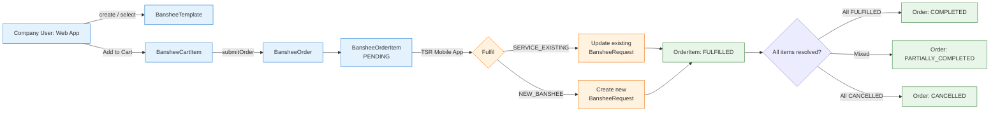

**Non-technical:** A Company User picks/creates a Banshee from the Scheduler, drops it into the Cart, then submits an Order with optional attachments and a comment. The Order shows up on the TSR's mobile app where each line item is either serviced (existing bolt) or registered (new bolt). The Order auto-rolls up to `COMPLETED` / `PARTIALLY_COMPLETED` / `CANCELLED` based on its line-items.

---

## 20. Updated Database Schema (ERD)

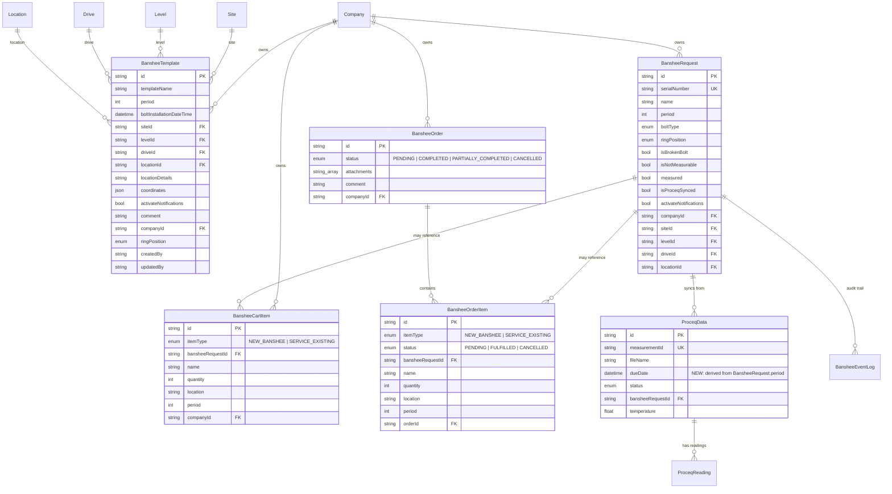

Migration reference: `apps/api/prisma/migrations/20260424105736_added/migration.sql` introduces `cart_items`, `orders`, `order_items` tables and the `BansheeCartItemType`, `BansheeOrderStatus`, `BansheeOrderItemStatus` enums.

---

## 21. Banshee Template Module — Detailed Breakdown

### 21.1 Purpose

`BansheeTemplate` is the reusable scaffold for the "create Banshee" flow. A template captures the Site / Level / Drive / Location hierarchy plus default fields (period, ring position, coordinates, notifications) so that a Company User can spawn a fully-formed Banshee from a known configuration without re-entering data each time.

### 21.2 Service Methods (`banshee-template.service.ts`)

| Method | Role |
|---|---|
| `createBansheeTemplate(input, user)` | Creates a template; rejects duplicate `templateName` per company; validates Site/Level/Drive/Location relations; stamps `createdBy/updatedBy = user.id`. |
| `updateBansheeTemplate(id, input, user)` | Updates an existing template; re-validates relations only when one of `levelId/driveId/locationId` is provided; stamps `updatedBy/updatedAt`. |
| `deleteBansheeTemplate(id, user)` | Hard-deletes a template after company-access check. |
| `findBansheeTemplateById(id, user)` | Single-template fetch with company access guard. |
| `findBansheeTemplates(companyId, user)` | Lists templates for a company. Calls `hasAppAccessForCompany(...BANSHEE)` first. |
| `validateUserCompanyAccess(user, companyId)` | Internal — checks `userPermission` row exists; bypassed for `GlobalRole.SANDVIK_ADMIN`. |
| `validateRelations(levelId?, driveId?, locationId?)` | Internal — verifies each id exists and the parent-child chain (drive → level, location → drive) is consistent. |

### 21.3 Validation Chain

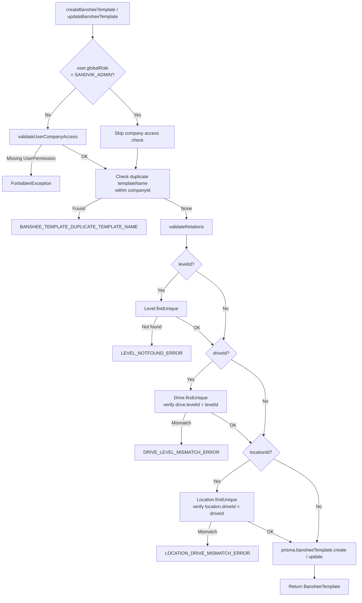

### 21.4 GraphQL API

| Operation | Args | Returns |
|---|---|---|
| Query `getBansheeTemplates` | `companyId` | `[BansheeTemplate!]!` |
| Query `getBansheeTemplateById` | `id` | `BansheeTemplate` |
| Mutation `createBansheeTemplate` | `createBansheeTemplateInput` | `BansheeTemplate!` |
| Mutation `updateBansheeTemplate` | `id, updateBansheeTemplateInput` | `BansheeTemplate!` |
| Mutation `deleteBansheeTemplate` | `id` | `BansheeTemplate!` |

All mutations and the by-id query are guarded by `@Roles([], [Application.BANSHEE], 'bansheeTemplate')`.

---

## 22. Banshee Request Module — Detailed Breakdown

### 22.1 Purpose

`BansheeRequest` is the canonical work-order record per bolt (one per `serialNumber`). It is the entity that Proceq measurements link to (via `serialNumber → ProceqData.bansheeRequestId`) and that drives the `dueDate` projection used for scheduling.

### 22.2 Service Surface (`banshee-request.service.ts`)

| Method | Role |
|---|---|
| `create(input, user)` | Creates a new request. Rejects duplicate `serialNumber`. Validates Level/Drive/Location chain. Persists uploaded images via `saveImage`. |
| `update(id, input, user)` | Updates the request. Re-validates relations on hierarchical changes. Stamps `updatedBy`. |
| `remove(id, user)` | Deletes a request. Cascades to `ProceqData`, `BansheeEventLog`, `BansheeCartItem`, `BansheeOrderItem` per Prisma relations. |
| `findAll(filter, allowedCompanyIds, allowedApps, user)` | Paginated list with multi-field filter (serialNumber, period, level/drive/location, dates, activateNotifications) and RBAC scoping. |
| `findOne(id, user)` | Single-request fetch with company-scope guard. |
| `getStatusDistribution({...}, allowedCompanyIds, user, allowedApps)` | Aggregates Proceq status counts grouped by location. |
| `getEventLogs({...}, allowedCompanyIds, user, allowedApps)` | Paginated event-log feed across requests. |

### 22.3 dueDate Derivation (Proceq Table Enhancement)

A new `dueDate DateTime?` column was added to `proceq_data`. It is populated automatically inside `proceq-sync.service.ts → processExportArchive()` when a measurement is matched to a `BansheeRequest`:

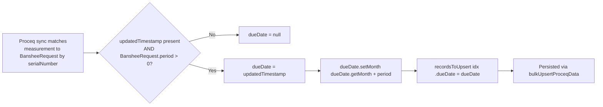

Source: [`proceq-sync.service.ts:800-806`](apps/api/src/proceq/proceq-sync.service.ts#L800-L806). The field powers downstream scheduling — Banshees nearing their `dueDate` are surfaced in the Scheduler UI for the user to drop into the Cart.

### 22.4 GraphQL API

| Operation | Args | Returns |
|---|---|---|
| Query `bansheeRequests` | `offset, limit, serialNumber, measured, period, levelId, driveId, locationId, createdBy, companyId, siteId, startDate, endDate, activateNotifications` | `BansheeRequestResponse` |
| Query `bansheeRequest` | `id` | `BansheeRequest` |
| Query `bansheeStatusDistribution` | `companyId, siteId, locationId, startDate, endDate` | `BansheeStatusDistribution` |
| Query `bansheeEventLogs` | `offset, limit, companyId, siteId` | `BansheeEventLogResponse` |
| Mutation `createBansheeRequest` | `createBansheeRequestInput` | `BansheeRequest!` |
| Mutation `updateBansheeRequest` | `id, updateBansheeRequestInput` | `BansheeRequest!` |
| Mutation `deleteBansheeRequest` | `id` | `BansheeRequest!` |

Mutations are guarded by `@Roles([], [Application.BANSHEE], 'bansheeRequest')`.

---

## 23. Banshee Cart Module — Detailed Breakdown

### 23.1 Purpose

The cart is an **ephemeral, per-company staging area** between the Scheduler and Order submission. A single company has at most one logical "active cart" — modelled as the set of `BansheeCartItem` rows for that `companyId`. Cart items are polymorphic via the `BansheeCartItemType` enum.

### 23.2 Polymorphic Item Shape

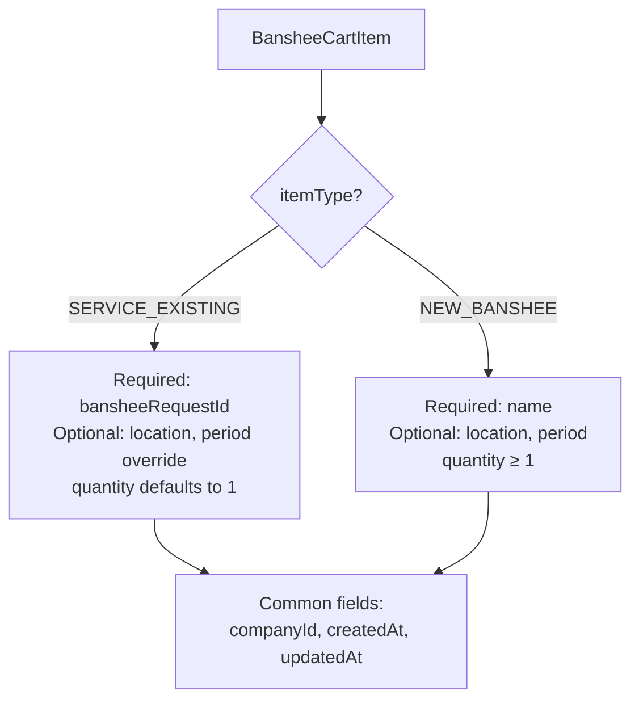

### 23.3 Service Methods (`banshee-cart.service.ts`)

| Method | Role |
|---|---|
| `getCartItems(companyId)` | Lists all cart items for a company, includes `bansheeRequest` & `company`, ordered by `createdAt DESC`. |
| `addCartItems(input[])` | Bulk add. Validates: `SERVICE_EXISTING` requires `bansheeRequestId`; `NEW_BANSHEE` requires `name`. Verifies every referenced `BansheeRequest` exists. Wraps inserts in a `prisma.$transaction`. |
| `deleteCartItem(id)` | Removes one cart item. Throws if not found. |
| `clearCart(companyId)` | Bulk delete every cart item for a company. Returns `true`. |

**Validation snippet** (`banshee-cart.service.ts:23-33`):

- `SERVICE_EXISTING` without `bansheeRequestId` → `UserInputError('bansheeRequestId is required for SERVICE_EXISTING items')`
- `NEW_BANSHEE` without `name` → `UserInputError('name is required for NEW_BANSHEE items')`

### 23.4 GraphQL API

| Operation | Args | Returns |
|---|---|---|
| Query `cartItems` | `companyId` | `[BansheeCartItem!]!` |
| Mutation `addCartItems` | `input: [AddCartItemInput!]!` | `[BansheeCartItem!]!` |
| Mutation `deleteCartItem` | `id` | `BansheeCartItem!` |
| Mutation `clearCart` | `companyId` | `Boolean!` |

All routes are guarded by `@Roles([], [Application.BANSHEE], 'bansheeCartItem')`.

---

## 24. Banshee Order Module — Detailed Breakdown

### 24.1 Purpose

The Order module finalises the cart into an immutable record consumed by Sandvik technicians via the TSR mobile app. Cart items are *snapshot-copied* into `BansheeOrderItem` rows at submission time so that subsequent edits to a `BansheeRequest` do not mutate historical orders.

### 24.2 `submitOrder` Flow

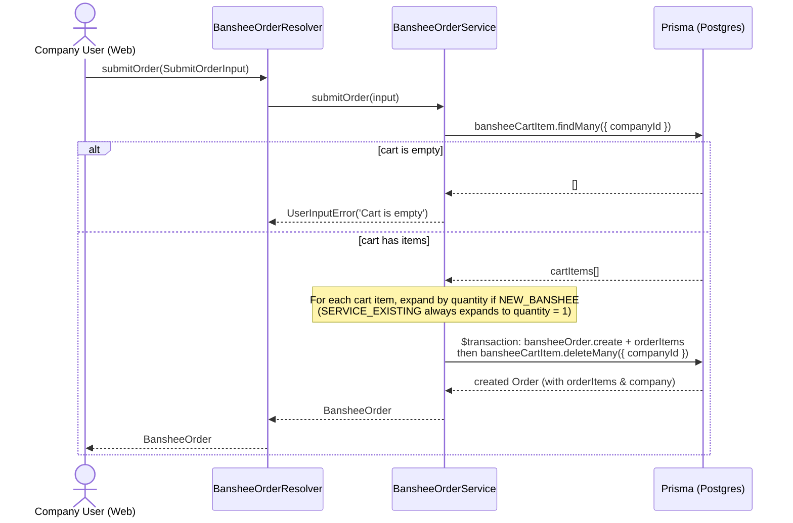

Source: [`banshee-order.service.ts:88-139`](apps/api/src/banshee-order/banshee-order.service.ts#L88-L139).

### 24.3 `fulfillOrderItem` Flow & Status Recompute

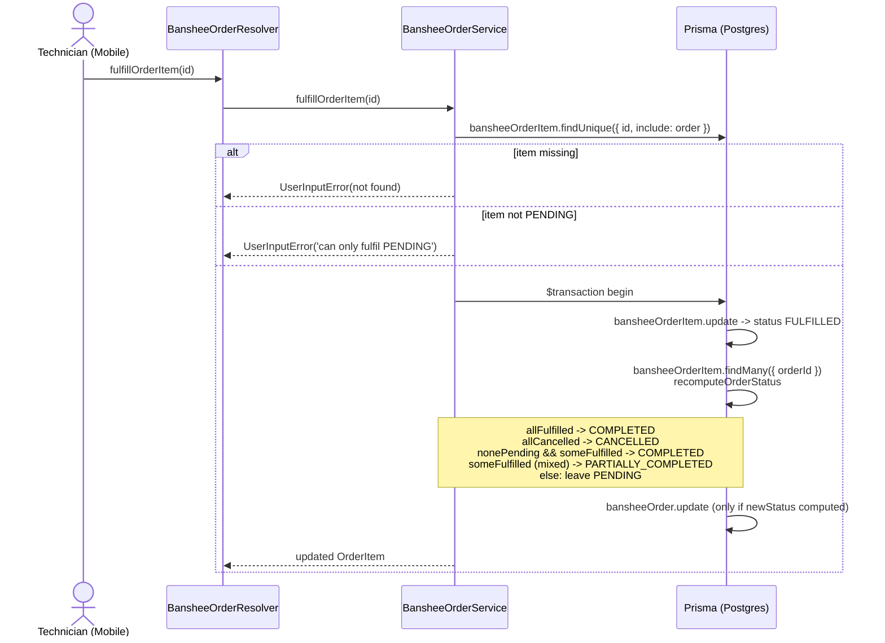

Source: [`banshee-order.service.ts:180-279`](apps/api/src/banshee-order/banshee-order.service.ts#L180-L279).

### 24.4 Order Lifecycle

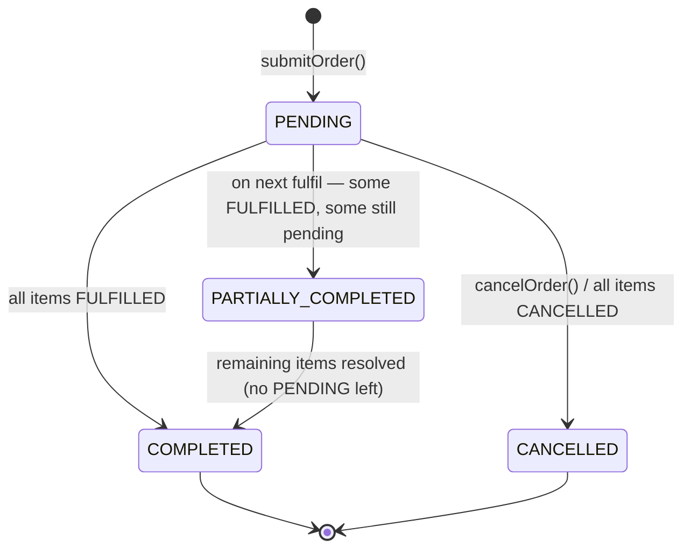

Order Item lifecycle:

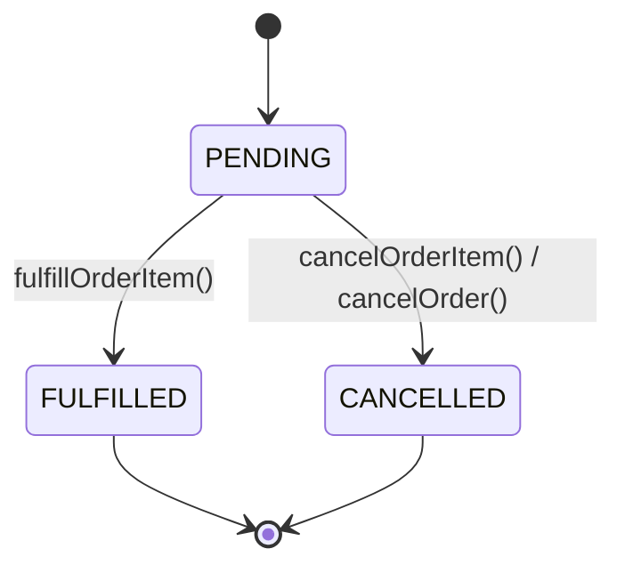

### 24.5 Service Methods

| Method | Role |
|---|---|
| `findAll(filter, offset, limit, user)` | Paginated order listing scoped by `getAllowedCompanyIds(user)`. Optional filters: status, companyId, startDate, endDate. |
| `findOne(id, user)` | Single order fetch with company-scope guard. |
| `submitOrder(input)` | Atomic cart→order conversion (see 24.2). |
| `cancelOrder(id, companyId)` | Cancels a non-completed order; sets all `PENDING` line-items to `CANCELLED`. |
| `fulfillOrderItem(id)` | Marks an order item `FULFILLED` and recomputes parent order status. |
| `cancelOrderItem(id)` | Marks an order item `CANCELLED` and recomputes parent order status. |
| `recomputeOrderStatus(tx, orderId)` | Internal — derives parent `BansheeOrderStatus` from the set of child statuses. |

### 24.6 GraphQL API

| Operation | Args | Returns |
|---|---|---|
| Query `orders` | `filter, offset, limit` | `OrdersResponse` (`totalRecords + results`) |
| Query `order` | `id` | `BansheeOrder` |
| Mutation `submitOrder` | `input: SubmitOrderInput!` | `BansheeOrder!` |
| Mutation `cancelOrder` | `id` | `BansheeOrder!` |
| Mutation `fulfillOrderItem` | `id` | `BansheeOrderItem!` |
| Mutation `cancelOrderItem` | `id` | `BansheeOrderItem!` |

Order routes are guarded by `@Roles([], [Application.BANSHEE], 'bansheeOrder')`; order-item routes by `@Roles([], [Application.BANSHEE], 'bansheeOrderItem')`.

---

## 25. RBAC — Role-Based Access Control

### 25.1 Coverage

RBAC is applied uniformly across every newly introduced and updated module:

| Module | Resource Key | Decorator |
|---|---|---|
| BansheeTemplate | `bansheeTemplate` | `@Roles([], [Application.BANSHEE], 'bansheeTemplate')` |
| BansheeRequest | `bansheeRequest` | `@Roles([], [Application.BANSHEE], 'bansheeRequest')` |
| BansheeCart | `bansheeCartItem` | `@Roles([], [Application.BANSHEE], 'bansheeCartItem')` |
| BansheeOrder | `bansheeOrder`, `bansheeOrderItem` | `@Roles([], [Application.BANSHEE], 'bansheeOrder' / 'bansheeOrderItem')` |

### 25.2 Guard Pipeline

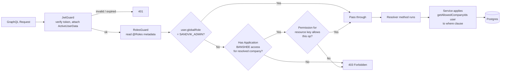

### 25.3 Centralised Building Blocks

- **`JwtGuard`** (`src/auth/guard/jwt.guard.ts`) — token verification & `ActiveUserData` injection.
- **`RolesGuard`** (`src/auth/guard/roles.guard.ts`) — reads the `@Roles` decorator and enforces both Global Role and Application × Resource permissions.
- **`getAllowedCompanyIds(user)`** (`src/utils/resolveAllowedCompanyIds.ts`) — derives the set of companies the user can see from `userPermission` rows; used inside services to scope queries.
- **`hasAppAccessForCompany(prisma, user, [Application.BANSHEE], companyId)`** — used by template list to short-circuit if the user lacks the BANSHEE app on that company.
- **`validateUserCompanyAccess(user, companyId)`** — service-level fallback used by the template module for write operations; bypassed for `GlobalRole.SANDVIK_ADMIN`.

### 25.4 Approval Workflow

Order fulfilment endpoints (`fulfillOrderItem`, `cancelOrderItem`) are scoped to the `bansheeOrderItem` resource key so that only roles with that permission grant — typically Sandvik TSR / official employees on the mobile app — can transition an Order Item to `FULFILLED`. Web-app Company Users hold `bansheeOrder` write permission (submit / cancel order) but not `bansheeOrderItem` fulfilment permission.

---

## 26. End-to-End Walkthrough

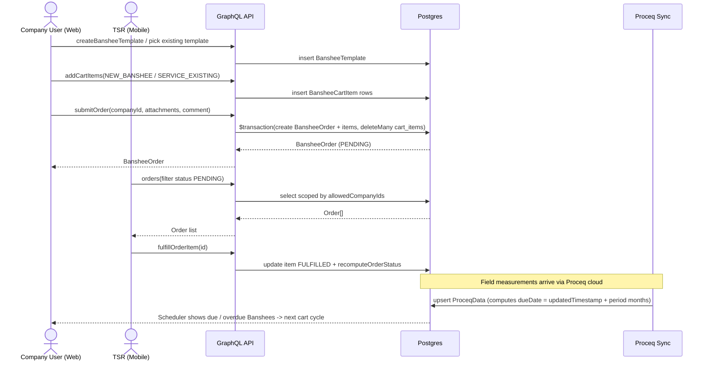
